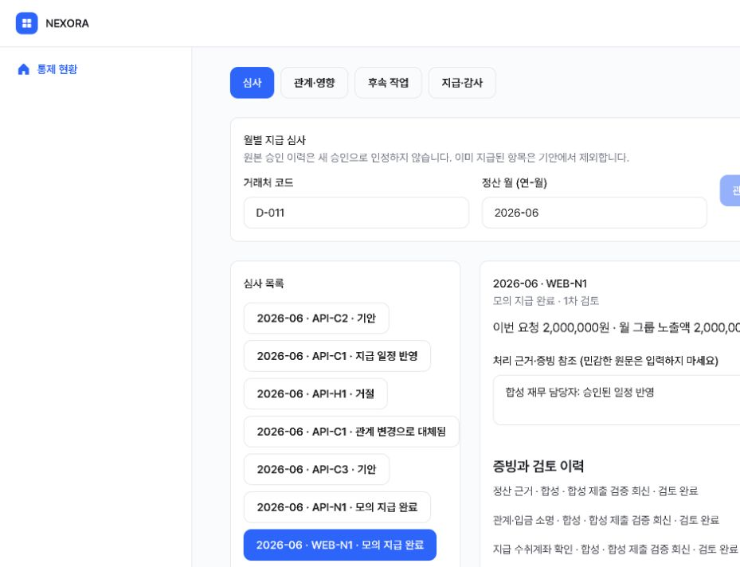
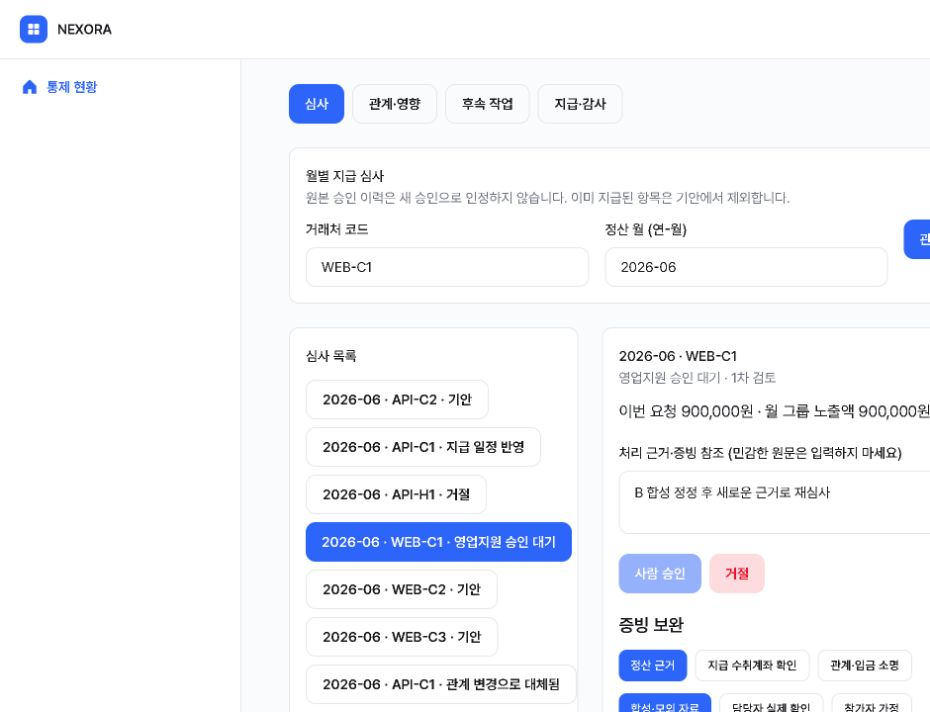
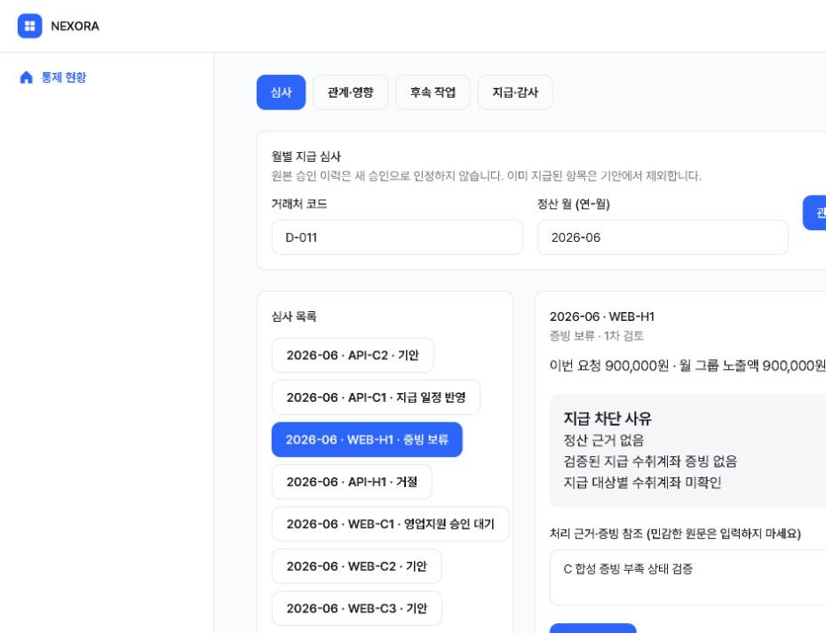
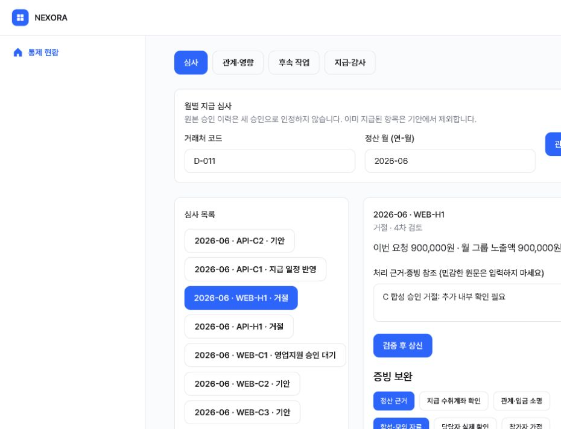

# NEXORA W07 제출 전 최종 검증

검증일: 2026-11-10 / 가상 업무 기준일: 2026-07-01.

## 판정

업무 규칙·예외·부서 후속 처리의 자동 검증과 실제 브라우저 시연을 수행했습니다. **외부 AI 실호출은 자격 증명 부재로 차단되어 있어 AI 운영 역할 항목은 조건부입니다.** 모의 모델 응답 검증을 실제 AI 연동 성공으로 계산하지 않습니다. 이 문서는 공식 점수나 합격을 보장하는 평가가 아닙니다.

## 평가 기준별 구현·검증 결과표

| 기준 | 구현 및 확인한 결과 | 검증 상태 | 증거 |
|---|---|---|---|
| 기업 운영의 이해·기획 | 영업지원의 그룹 심사, 영업 소명, 임원 최종 승인, 재무 일정·모의 지급 연결 | 확인 | A04_DRAFT.md, API·브라우저 A/B/C |
| 데이터에 근거한 판단 | UTF-8 파이프 원본, 파일 해시·행 계보, 대표자·주소·등록계좌 2개 이상 직접 일치 및 전이 그룹 | 통과 | test_real_source_reconciliation, source-preservation.json |
| 원본 검산 | 50개 거래처·240건·232,865,386원, D-011/D-024/D-037의 6월 3,888,097원 | 통과 | 원본 검산 테스트 |
| 입금·지급 계좌 구분 | 입금 불일치는 소명 신호, 별도 지급 계좌 증빙 없이는 보류 | 통과 | test_every_payout_requires_own_verified_evidence, 브라우저 C |
| 승인 경계 | 정확히 200만 원은 영업지원 전결, 초과는 영업지원 절차 이후 영업임원 최종 승인 필수 | 통과 | test_normal_limit_and_duplicate, test_executive_gate_cannot_be_satisfied_by_support_twice |
| 기안자·승인자 분리 | 동일 계정 승인 거부 및 화면 버튼 비활성화 | 통과 | test_stale_and_self_approval_and_evidence, 브라우저 A |
| 변경·예외 대응 | 취소·계좌/금액/관계 정정 시 승인 무효화, 일정 중지, 새 회차·대체 심사 | 통과 | 금액 정정·관계 분리·취소/지급 경합 테스트, 브라우저 B |
| 필수 전문성 확장 | 관계 변경의 영향 범위와 그룹 합계·필요 권한의 전후 비교, 기존 심사 대체 및 재심사 | 통과 | API B, browser-B.png |
| 다른 부서 영향 | 영업 보완 작업 생성·검토 완료, 재무 일정의 승인/중지/거절 취소 차이 | 통과 | test_sales_task_completion_and_finance_rejection_schedule, 브라우저 C, snapshot |
| 모의 지급·감사 | 요청/지급/항목 유일성, 동시 요청 직렬화, DB 상태·지급 항목·감사 원자적 저장 | 통과 | atomic·concurrent·race 테스트 |
| AI 구조화·근거 통제 | 관계 근거·지급 위험·증빙 부족·부서 작업 JSON, 존재하는 근거만 허용, 규칙 결과는 서버 첨부 | 구현·모의 응답 검증 통과 | backend/analysis.py, test_submission.py |
| AI 실패 처리 | 타임아웃·HTTP 오류·잘못된 JSON/스키마·허위 근거·금액 필드 삽입을 거부하고 실패 감사 기록 | 통과 | 매개변수화한 AI 실패 테스트 6건 |
| AI 실제 운영 | 로컬/운영에 LLM_API_KEY·LLM_BASE_URL·LLM_MODEL 없음, 테넌트 AI 제공자 비활성 | **차단** | provider-check.json, 실제 모델 테스트 1건 건너뜀 |
| 웹앱 실제 동작 | 브라우저 기안에서 발견한 프록시 출처 검사 오류 수정 및 교차 출처 차단 유지 | 수정 후 통과 | origin-tests.log, browser-verification.json |
| 원본·기록 키 보호 | 원본 3개 SHA-256 동일, 보호 설정 변경 없음, 커밋 전 비밀 값·추적 경로 검사 | 확인 | source-preservation.json, 보안 검사 |
| 기존 AXHub 앱 재배포 | lounge의 기존 nexora 저장소를 재사용하고 해당 배포를 별도 검증 | 배포 증거 별첨 참조 | DEPLOYMENT.md, evidence/deployment.json |

## 테스트 결과와 재현

- PostgreSQL 최종 실행: **28개 통과, 외부 AI 1개 차단/건너뜀**, 실패 0개. 테스트 이름별 상태와 검사한 소스 SHA-256은 [tests-latest.json](evidence/tests-latest.json)에 있습니다. 전체 JUnit·실행 로그도 evidence 폴더에 보관합니다.
- 출처 검사 회귀: Node 테스트 2개 통과. 공개 Host와 내부 리스너 주소가 달라도 같은 출처 요청을 허용하고, 다른 사이트·잘못된 Origin·위조된 forwarded-host 우회는 차단합니다.
- 실제 HTTP 시연: [api-demo.json](evidence/api-demo.json). Next 서버의 인증 서명 → FastAPI → PostgreSQL을 거쳤습니다. A의 외부 AI만 차단이며 A의 나머지 흐름, B, C는 통과했습니다.
- 실제 브라우저: [browser-verification.json](evidence/browser-verification.json), [최종 DB·작업·감사 스냅샷](evidence/browser-api-snapshot.json). 임시 DB 재개 후에도 A/B의 처리 이력을 보존했습니다.
- 화면·형식: TypeScript, ESLint, 디자인 검사, Next 운영 빌드 통과. 이번 시연의 역할과 증빙은 합성입니다. 운영 실사용자들이 실제 승인한 기록으로 주장하지 않습니다.

프로젝트 폴더에서 다음을 실행합니다. 기존 PostgreSQL 인스턴스 대신 새로운 임시 클러스터를 사용합니다.

```text
python scripts/test-postgres.py
node --test tests/request-origin.test.mjs
node node_modules/typescript/bin/tsc --noEmit
npm run lint
bash scripts/check-design.sh
npm run build -- --webpack
python scripts/demo-server.py
# 다른 터미널에서:
python scripts/demo-api.py all
python scripts/demo-api.py snapshot
python scripts/demo-api.py stop
```

PostgreSQL 바이너리가 기본 Windows 설치 경로와 다르면 PG_BIN을 지정합니다. 로컬 시연에는 Python·의존성과 빌드된 Next 앱이 필요합니다. 새 데모 서버는 합성 데이터만 등록합니다. 운영 DB 주소를 입력받지 않습니다. 재개 옵션은 OS 임시 경로의 `nexora-submission-demo-*` 클러스터 중 합성 시연 표식이 있는 데이터만 허용합니다.

## 발견한 실패와 수정

1. 첫 확장 테스트에서 AI의 금액 삽입 응답을 거부한 뒤 DB에 재접속하는 과정에서 8초 연결 시간 초과가 한 번 발생했습니다. 첫 실행은 26 통과·1 실패·1 차단입니다. [initial-run.json](evidence/initial-run.json)에 남겼으며, 검사 조건이나 타임아웃을 완화하지 않은 후속 두 실행에서 각각 27 통과·1 차단으로 재현되지 않았습니다. 최초 연결 지연의 근본 원인은 확정하지 않습니다.
2. 최초 브라우저 기안은 403으로 실패했습니다. Next의 내부 리스너 주소와 브라우저 공개 출처를 직접 비교한 것이 원인이었습니다. 실제 요청 Host와 Origin을 비교하도록 수정하고, forwarded-host를 신뢰하지 않으며 cross-site 요청 차단을 유지했습니다. 원본 실패 스냅샷은 [initial-browser-origin-failure.json](evidence/initial-browser-origin-failure.json)에 보존합니다.
3. Windows 임시 서버 실행에서 백그라운드 PostgreSQL이 상속한 출력 파이프 때문에 시작 대기가 끝나지 않았습니다. 테스트 실행기의 출력 처리만 바꿨고, 해당 임시 서버를 중지 후 재개했습니다. 운영 데이터나 승인 기준을 변경하지 않았습니다.

## 미구현·제약 사항

- 외부 AI 실제 호출과 그 결과의 운영 적용은 아직 검증하지 못했습니다. [AI_SETUP.md](AI_SETUP.md)의 서버 설정 후 실제 모델 테스트와 A 전체 흐름을 다시 실행해야 합니다.
- 관계 정정 적용일은 가상 기준일 2026-07-01만 지원합니다. 임의 과거 시점 그래프·미래 예약 변경은 없습니다.
- 금액 정정 API는 있으며 전용 입력 화면은 없습니다.
- 지급은 모의 영수증·상태 기록입니다. 은행 이체·은행 대사·실제 현금 잔액 검증·외부 알림 전송은 없습니다.
- 원본에는 당시 마스터·영업임원 승인서·검증된 지급 수취계좌가 없습니다. 현재 마스터에 의한 과거 재검산은 사후 확인 신호입니다. 부정 또는 과거 승인 부재를 확정하지 않습니다.
- 소규모 W07 데이터를 위한 테넌트 단위 PostgreSQL 잠금을 사용합니다. 대규모 처리량 시험은 수행하지 않았습니다.
- 부서 작업 완료에 사용한 회신·승인 역할은 자동 검증용 합성 자료입니다. 실제 업무 효과나 현금 절감액을 측정한 것은 아닙니다.

## 시연 이미지





